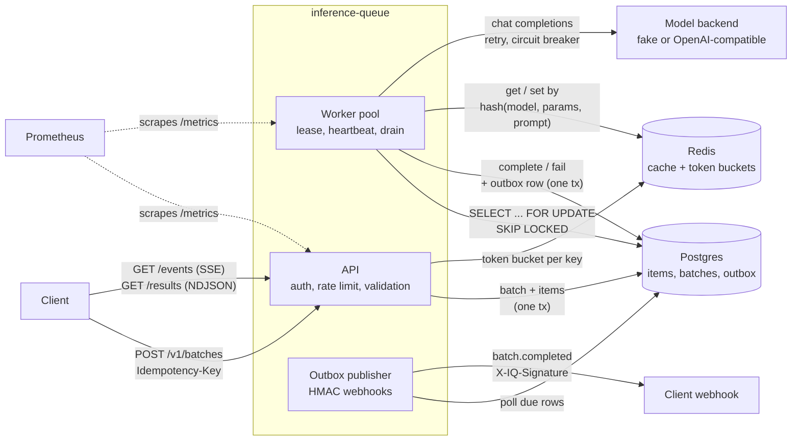

# inference-queue

A small, self-hostable batch inference gateway. Clients POST a batch of prompts
(or an eval dataset with expected answers) to a REST API. The service splits it
into items, queues them in Postgres, and a pool of workers calls a model
backend. Results are stored and streamable, and the batch reports progress over
Server-Sent Events and a signed webhook when it finishes.

It is written in Go with the standard library router, Postgres as the durable
queue, and Redis as an optional result cache and rate limiter. It runs without
any paid API: the default model is a deterministic fake, and the real backend
speaks the OpenAI `/v1/chat/completions` protocol, so it works with a local
llama.cpp or vLLM server.

## Architecture



Redis is optional. Without `REDIS_URL` the cache and the rate limiter fall back
to in-process memory, so a single instance still works; with several instances
you want Redis so they share both.

## Features

- REST API on `net/http`, with an OpenAPI 3 document at `api/openapi.yaml`.
  A test fails if the registered routes and the spec disagree.
- Postgres queue: `FOR UPDATE SKIP LOCKED` leasing, lease expiry, attempt
  counter, exponential backoff with jitter, and a dead-letter state.
- Idempotent batch creation with the `Idempotency-Key` header.
- API keys stored as sha256 hashes, compared in constant time, with `submit`,
  `read` and `admin` scopes and a per-key token bucket.
- Result cache keyed by `hash(model, params, prompt)`, plus in-process
  collapsing of identical concurrent prompts.
- Model backends behind one interface: a fake with configurable latency and
  error rate, and an OpenAI-compatible client with timeouts, retry on 429 and
  5xx honouring `Retry-After`, and a circuit breaker.
- Progress over SSE, results as NDJSON, and a transactional outbox that
  delivers `batch.completed` to a webhook with an HMAC signature and retries.
- Structured logs with request ids, Prometheus metrics, optional OpenTelemetry
  tracing, `/healthz` and `/readyz`.
- Graceful shutdown: workers stop leasing, drain in-flight items, and release
  what is left without charging an attempt.
- Multi-stage distroless non-root image, a compose stack, Kubernetes manifests,
  and a GitHub Actions workflow.

## Quickstart

### With Docker

```sh
docker compose up --build -d
# API on :8080, Prometheus on :9091. The bootstrap admin key is set in compose.
export ADMIN=iq_dev_admin_key_change_me
```

### Without Docker

You need Postgres (tested on 16). Redis is optional.

```sh
export DATABASE_URL='postgres://iq@127.0.0.1:5432/iq?sslmode=disable'
export BOOTSTRAP_ADMIN_KEY=iq_dev_admin_key_change_me
go run ./cmd/api -with-worker       # API, worker pool and webhook publisher in one process
export ADMIN=$BOOTSTRAP_ADMIN_KEY
```

Migrations run on startup under an advisory lock, so several processes can
start at once.

### Try it

The responses below are real output from a local run (Postgres 16, Redis
protocol server, separate `api` and `worker` binaries). Keys and ids will
differ.

Create a client key:

```sh
curl -s -X POST localhost:8080/v1/keys \
  -H "Authorization: Bearer $ADMIN" -H 'Content-Type: application/json' \
  -d '{"name":"demo","scopes":["submit","read"]}'
```
```json
{"id":"17dd77e8-db06-48c6-bfaa-48fb58f1aac0","name":"demo","scopes":["read","submit"],"rate_rps":20,"rate_burst":40,"created_at":"2026-11-14T13:23:12.614283+02:00","key":"iq_5b8b3a51..."}
```

The plaintext `key` is shown once; only its sha256 is stored. Submit an eval
dataset. The fake model returns the text after `echo:`, which makes scoring
visible:

```sh
export KEY=iq_...   # from the response above
curl -s -i -X POST localhost:8080/v1/batches \
  -H "Authorization: Bearer $KEY" -H 'Content-Type: application/json' \
  -H 'Idempotency-Key: demo-1' \
  -d '{"model":"fake-1","params":{"temperature":0},"dataset":[
        {"ref":"q1","prompt":"echo: 4","expected":"4"},
        {"ref":"q2","prompt":"echo: Paris","expected":"paris"},
        {"ref":"q3","prompt":"echo: blue","expected":"red"},
        {"ref":"q4","prompt":"What is the capital of France?"},
        {"ref":"q5","prompt":"What is the capital of France?"},
        {"ref":"q6","prompt":"Summarise the plot of Hamlet in one line."}]}'
```
```
HTTP/1.1 202 Accepted
Location: /v1/batches/91e566a2-ccb3-4f69-9b18-89c6944be531
X-Request-Id: c768e1274ec4de26

{"id":"91e566a2-...","model":"fake-1","params":{"temperature":0},"status":"queued","total":6,"succeeded":0,"failed":0,"scored":0,"matched":0,"pending":6,...}
```

Watch progress over SSE. A longer batch (80 prompts, 100 ms fake latency, 8
workers) streams like this:

```sh
curl -N localhost:8080/v1/batches/$ID/events -H "Authorization: Bearer $KEY"
```
```
progress queued    succeeded=0/80
progress running   succeeded=32/80
progress running   succeeded=71/80
progress completed succeeded=80/80
done     completed succeeded=80/80
```

Each `data:` line is the full batch JSON; the lines above show the status and
counters. Fetch results as NDJSON, one finished item per line, ordered by index
(`?after=<index>` resumes, `?include_prompt=true` echoes prompts):

```sh
curl -s localhost:8080/v1/batches/$ID/results -H "Authorization: Bearer $KEY"
```
```json
{"index":0,"ref":"q1","status":"succeeded","output":"4","expected":"4","matched":true,"cached":false,"attempts":1,"prompt_tokens":2,"completion_tokens":8,"latency_ms":125}
{"index":1,"ref":"q2","status":"succeeded","output":"Paris","expected":"paris","matched":false,"cached":false,"attempts":1,"prompt_tokens":2,"completion_tokens":8,"latency_ms":102}
{"index":2,"ref":"q3","status":"succeeded","output":"blue","expected":"red","matched":false,"cached":false,"attempts":1,"prompt_tokens":2,"completion_tokens":8,"latency_ms":115}
```

Scoring is exact match after trimming whitespace, case sensitive, so `Paris`
against `paris` is a miss. Repeat the same request with the same
`Idempotency-Key` and you get the original batch back; change the body and you
get a conflict:

```sh
# same key, same body: 200 OK, header "Idempotent-Replayed: true", same batch id
# same key, different body:
curl -s -i -X POST localhost:8080/v1/batches ... -H 'Idempotency-Key: demo-1' \
  -d '{"model":"fake-1","prompts":["different"]}'
```
```
HTTP/1.1 409 Conflict
{"error":{"code":"idempotency_conflict","message":"this Idempotency-Key was already used with a different request body"}}
```

A key without the `admin` scope is refused on admin routes:

```
HTTP/1.1 403 Forbidden
{"error":{"code":"forbidden","message":"this key lacks the admin scope"}}
```

If you pass `webhook_url` (or set `WEBHOOK_URL` service-wide), a
`batch.completed` event is posted when the batch finishes:

```
POST /hook
X-IQ-Event: batch.completed
X-IQ-Event-Id: 1
X-IQ-Signature: t=1794655393,v1=3ffa28afa8121c6c...

{"batch_id":"91e566a2-...","status":"completed","model":"fake-1","total":6,"succeeded":6,"failed":0,"scored":3,"matched":1,...}
```

The signature is `HMAC-SHA256(secret, "<t>.<body>")` in hex. Receivers should
verify it, reject timestamps that are too old, and de-duplicate on
`X-IQ-Event-Id` because delivery is at least once. Webhook targets on loopback
or private addresses are refused unless `WEBHOOK_ALLOW_PRIVATE=true`.

To use a real model, point the worker at any OpenAI-compatible server:

```sh
MODEL_BACKEND=openai MODEL_BASE_URL=http://localhost:8081 go run ./cmd/api -with-worker
# then use the model name that server expects in the "model" field
```

## HTTP API

| Method and path | Scope | Purpose |
|---|---|---|
| `POST /v1/batches` | submit | Create a batch (`prompts` or `dataset`). `202`, or `200` on an idempotent replay. |
| `GET /v1/batches` | read | List your batches. |
| `GET /v1/batches/{id}` | read | Batch with progress counters and eval score. |
| `GET /v1/batches/{id}/events` | read | SSE progress stream. |
| `GET /v1/batches/{id}/results` | read | NDJSON of finished items. |
| `POST /v1/batches/{id}/replay` | admin | Re-queue dead-lettered items. |
| `POST /v1/keys`, `GET /v1/keys`, `DELETE /v1/keys/{id}` | admin | Manage API keys. |
| `GET /healthz`, `GET /readyz`, `GET /metrics`, `GET /openapi.yaml` | none | Operations. |

`read` and `submit` keys only see their own batches; `admin` sees all.

## Configuration

All configuration is environment variables. The ones you will touch:

| Variable | Default | Meaning |
|---|---|---|
| `DATABASE_URL` | required | Postgres connection string. |
| `REDIS_URL` | empty | Enables the shared cache and rate limiter. Empty means in-memory. |
| `BOOTSTRAP_ADMIN_KEY` | empty | Seeds an admin key at startup so the first key can be created. |
| `WORKER_CONCURRENCY` | 8 | Items processed at once per worker process. |
| `LEASE_DURATION` | 60s | Lease length. Heartbeats extend it while a call is running. |
| `MAX_ATTEMPTS` | 5 | Default attempts per item before dead-lettering. |
| `BACKOFF_BASE`, `BACKOFF_MAX` | 2s, 5m | Retry backoff bounds. |
| `MODEL_BACKEND` | fake | `fake` or `openai`. |
| `MODEL_BASE_URL`, `MODEL_API_KEY` | empty | The OpenAI-compatible server. |
| `FAKE_LATENCY`, `FAKE_ERROR_RATE` | 50ms, 0 | Fake model behaviour. |
| `WEBHOOK_URL`, `WEBHOOK_SECRET` | empty | Default webhook target and HMAC key. |
| `OTEL_EXPORTER_OTLP_ENDPOINT` | empty | Tracing is a no-op until this is set. |

The full list is in `internal/config/config.go`.

## Design decisions

The longer version, including failure modes and delivery semantics, is in
[docs/DESIGN.md](docs/DESIGN.md). The short version:

- **Postgres as the queue.** At the volumes a batch inference gateway sees
  (items that each take hundreds of milliseconds to minutes), a database queue
  gives transactional enqueue, durable state, and one thing to operate. Kafka
  earns its place at much higher event rates or with many independent consumers.
- **Leases, not locks.** A worker holds a time-limited lease on an item. If it
  dies, the lease expires and another worker takes the item. Every state change
  is fenced on the lease owner and attempt number, so a slow worker that lost
  its lease cannot overwrite the new owner's result.
- **At-least-once model calls, one recorded result.** A crash can cause a
  second model call for the same item. The result is recorded once.
- **Outbox for events.** The `batch.completed` row is written in the same
  transaction that finishes the batch, so the event exists if and only if the
  state change committed.
- **Fail open on optional dependencies.** A Redis outage costs cache hits and
  shared rate limits, not availability.

## Testing

```sh
go vet ./...
go test -race ./...
```

`go test ./...` works on a bare machine. Integration tests run against a real
Postgres (an embedded Postgres 16 binary, downloaded on first run) and a Redis
protocol server (miniredis, in process). Set `TEST_DATABASE_URL` and
`TEST_REDIS_URL` to use real servers instead, which is what CI does.

Coverage includes: leasing under concurrent leasers, lease expiry recovery,
fencing of stale workers, backoff, dead-lettering, idempotency including a
concurrent race, cache keys, the token bucket in memory and in Redis, HMAC
signing, the circuit breaker, a 16-worker test that asserts every item is
processed exactly once, a crash test where a worker dies mid-lease and the item
is retried after the lease expires, graceful shutdown, webhook delivery with
retries, and the OpenAPI route check.

A load generator lives in `cmd/loadtest`. Results and the machine they were
measured on are in [docs/BENCHMARKS.md](docs/BENCHMARKS.md).

## Layout

```
cmd/api          REST API (add -with-worker to run everything in one process)
cmd/worker       worker pool, outbox publisher, health and metrics listener
cmd/loadtest     load generator
api/             OpenAPI document, embedded and served at /openapi.yaml
migrations/      embedded SQL migrations
internal/
  queue/         leasing, backoff, fenced state transitions, outbox write
  worker/        pool: heartbeat, reaper, cache lookup, shutdown
  model/         backend interface, fake, OpenAI client, circuit breaker
  cache/         key derivation, memory and Redis stores
  ratelimit/     token bucket, memory and Redis (Lua)
  events/        HMAC signing, outbox publisher, SSRF-safe HTTP client
  server/        handlers, SSE, middleware
  store/         pool, migrations, repositories
  auth/ config/ obs/ app/ testutil/
deploy/ k8s/ Dockerfile docker-compose.yml .github/workflows/ci.yml
docs/            DESIGN, RUNBOOK, BENCHMARKS
```

## Known limits

No batch cancellation, no priorities between batches, no retention job for old
batches, and SSE polls the database rather than using LISTEN/NOTIFY. These are
discussed in DESIGN.md along with what I would do about each.

## Related work

- [gs-code](https://github.com/Matthew-Klette/gs-code): TypeScript CLI and VS Code extension.
- [synthetic-crowd](https://github.com/Matthew-Klette/synthetic-crowd): Python, many parallel headless LLM calls.
- [Android-TeeUp](https://github.com/Matthew-Klette/Android-TeeUp): Kotlin, offline sync.

## License

MIT, see [LICENSE](LICENSE).
